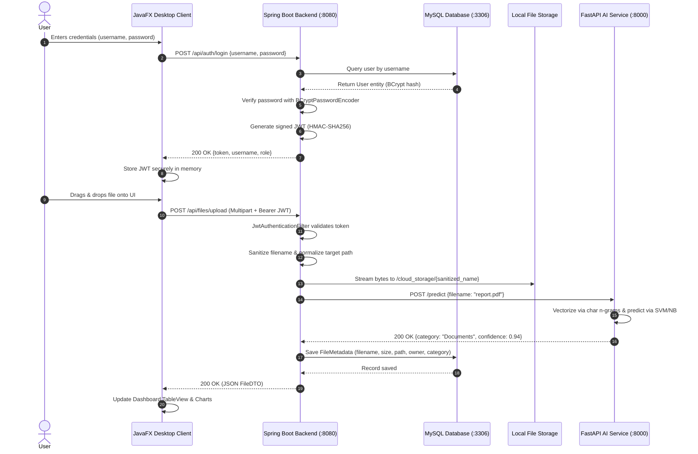

# 02. Architectural Design & Component Specifications

## 1. System Architecture Overview

The system is architected as a decoupled, multi-tiered distributed application adhering to the **Separation of Concerns** and **Single Responsibility** principles. 

---

## 2. Component Specifications

### 2.1 Component 1: JavaFX Desktop Client (Presentation Layer)
* **Runtime:** Java 17, JavaFX 17 / OpenJFX, Maven.
* **Responsibilities:**
  - Provide an intuitive, dark-themed desktop graphical interface.
  - Coordinate scene switching via `SceneManager` (`LoginScreen`, `RegisterScreen`, `DashboardScreen`).
  - Securely retain the JWT bearer token in application state for the session duration.
  - Support native **Drag-and-Drop** file ingestion via JavaFX `Dragboard`.
  - Provide interactive file filtering by AI category (`All`, `Documents`, `Images`, `Videos`, `Audio`, `Code`, `Archives`).
  - Render dynamic storage utilization analytics using JavaFX `PieChart` / `BarChart`.
* **Network Services:**
  - `AuthNetworkService`: Handles login/registration HTTP POST calls, deserializes JSON token responses.
  - `FileNetworkService`: Automates multipart streaming with `Authorization: Bearer <token>` header injection, parses JSON responses into typed Java observable lists.

### 2.2 Component 2: Spring Boot REST API (Control Plane)
* **Runtime:** Spring Boot 3.x / 4.x, Java 17, Spring Security 6.x, Spring Data JPA.
* **Responsibilities:**
  - Acts as the central **Control Plane** managing metadata, security policy, and business logic.
  - **Spring Security Configuration:**
    - Stateless `SessionCreationPolicy.STATELESS`.
    - Custom `JwtAuthenticationFilter` reading `Authorization: Bearer <token>`.
    - `BCryptPasswordEncoder` (cost factor 10+) for one-way password hashing.
  - **Security & Authorization Enforcement:**
    - `PathTraversalFilter` / `FileStorageService`: Normalizes filesystem targets using `Path.normalize().toAbsolutePath()` and validates that the resolved path starts with the base upload directory.
    - **IDOR Protection:** Validates that `fileMetadata.getUploadedBy().equals(authenticatedUsername)` on every download, read, or delete request.
  - **REST API Endpoints (Standardized JSON):**
    - `POST /api/auth/register` $\rightarrow$ Registers user with BCrypt hashed password.
    - `POST /api/auth/login` $\rightarrow$ Returns JWT bearer token.
    - `POST /api/files/upload` $\rightarrow$ Accepts multipart file, persists to disk, calls AI service, saves metadata.
    - `GET /api/files/list` $\rightarrow$ Returns JSON array `List<FileMetadataDTO>` owned by user.
    - `GET /api/files/download/{id}` $\rightarrow$ Verifies ownership, streams binary file.
    - `DELETE /api/files/delete/{id}` $\rightarrow$ Verifies ownership, removes file from disk and record from DB.

### 2.3 Component 3: FastAPI AI Microservice (Inference & Comparative Engine)
* **Runtime:** Python 3.10+, FastAPI, Uvicorn, Scikit-Learn, Joblib, NumPy, Pandas.
* **Responsibilities:**
  - High-performance, non-blocking asynchronous REST endpoint serving ML inference.
  - **Feature Extraction:** `TfidfVectorizer(analyzer='char_wb', ngram_range=(2, 5))` extracting character n-grams from filenames.
  - **Classification Models:**
    1. `MultinomialNB()`: Fast probabilistic baseline.
    2. `LinearSVC()`: Maximum-margin hyperplane classifier optimized for high-dimensional sparse text.
  - **Model Persistence:** Pre-trains models on an expanded 500+ sample dataset and serializes them using `joblib` for instant startup.
  - **Endpoints:**
    - `POST /predict`: Accepts `{"filename": "..."}`, returns `{"category": "...", "confidence": 0.95, "model_used": "LinearSVC"}`.
    - `POST /evaluate`: Computes and returns full comparative metrics (Accuracy, Precision, Recall, F1, Confusion Matrix) between NB and SVM for the academic study.
    - `GET /health`: Diagnostic health check.

### 2.4 Component 4: Persistence & Storage Engine (Data Plane)
* **Control Plane Database:** MySQL 8.x
  - Table `users`: `id (BIGINT PK)`, `username (VARCHAR UNIQUE)`, `password_hash (VARCHAR)`, `created_at (TIMESTAMP)`.
  - Table `files`: `id (BIGINT PK)`, `file_name (VARCHAR)`, `sanitized_name (VARCHAR)`, `file_type (VARCHAR)`, `file_size (BIGINT)`, `server_path (VARCHAR)`, `uploaded_by (VARCHAR, FK/Index)`, `category (VARCHAR)`, `upload_date (TIMESTAMP)`.
* **Data Plane Storage:** Local filesystem directory (`/cloud_storage/`) with restricted OS permissions, separated completely from database transactions to guarantee sub-millisecond database queries.

### 2.5 Component 5: Orchestration (Docker Compose)
* Defines a declarative multi-container environment:
  - `mysql`: Database container with initialized schema and persistent volume (`mysql_data`).
  - `fastapi-ai`: Python container running Uvicorn on port 8000.
  - `backend`: Spring Boot container depending on `mysql` and `fastapi-ai` with health check synchronization.
  - Shared bridge network (`cloud_net`) enabling secure internal service discovery by hostname.
