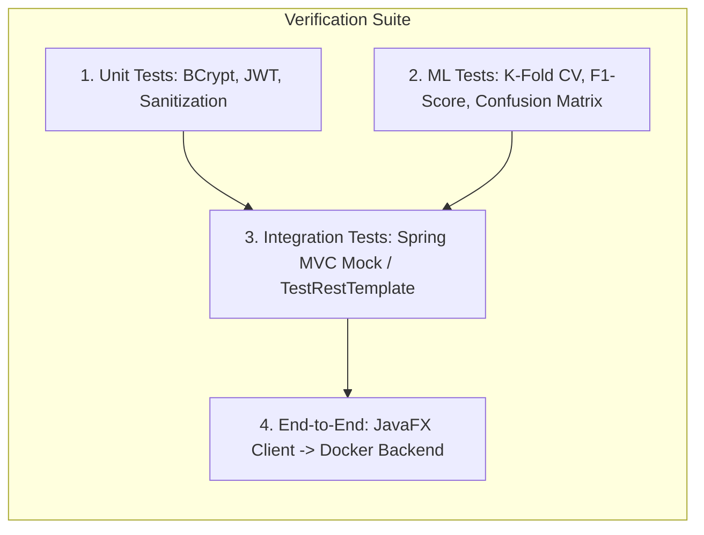

# 04. Implementation Roadmap & Milestones

This document defines the structured, chronological implementation plan to be executed in the new git branch (`feature/intelligent-cloud-drive`).

---

## 📅 Timeline Alignment with Academic Milestones

| Academic Milestone | Target Window | Project Deliverables |
| :--- | :--- | :--- |
| **Review 2** | *Completed (August 2026)* | Literature Review (10 papers), System Design, Synopsis Approval. |
| **Review 3** | **Late Sept 2026 (~30 Sept)** | 60% Core Implementation: Security hardening (BCrypt/JWT), AI Model training & evaluation (NB vs. SVM), Backend REST migration. |
| **Draft Review** | **12 – 16 Oct 2026** | 90% Implementation: JavaFX Drag-and-Drop & Charts, Docker Compose, 60–70 page Draft Dissertation (<15% similarity). |
| **Final Viva** | **28 Oct 2026** | 100% Polish: Final live demo, benchmark results presentation, project code delivery. |

---

## 🛠️ Step-by-Step Implementation Phases

### Phase 1: Security Hardening & Authentication Upgrade (Sprint 1)
*Goal: Eliminate plain-text passwords and implement stateless authentication.*
1. **Add Dependencies:** Update `Cloud_Backend_Workspace/backend/pom.xml` with `spring-boot-starter-security` and `jjwt-api`, `jjwt-impl`, `jjwt-jackson` (v0.12.x).
2. **Implement BCrypt:** Configure `BCryptPasswordEncoder` bean; update `AuthController.registerUser` to hash incoming passwords before persisting.
3. **JWT Infrastructure:**
   - Create `JwtTokenProvider.java`: Handles HMAC-SHA256 token generation and validation.
   - Create `JwtAuthenticationFilter.java`: Intercepts incoming HTTP requests, extracts bearer tokens, and sets authentication context.
   - Configure `SecurityConfig.java`: Permit public access to `/api/auth/**` and `/admin/**`, secure `/api/files/**` with JWT.
4. **Vulnerability Remediation:**
   - **Path Traversal Fix:** Refactor `FileController.java` to use `Path.normalize()` and reject any paths that attempt to escape `cloud_storage/`.
   - **IDOR Remediation:** Implement `checkFileOwnership(Long fileId, String username)` on `/download/{id}` and `/delete/{id}`.

---

### Phase 2: AI Microservice & Empirical ML Benchmark (Sprint 2)
*Goal: Expand the dataset, build the comparative pipeline (NB vs. Linear SVM), and implement evaluation metrics.*
1. **Dataset Expansion:**
   - Create `model/dataset.py` with 500+ diverse filenames across the 6 target categories (`Documents`, `Images`, `Videos`, `Audio`, `Code`, `Archives`).
2. **Pipeline Development:**
   - Build `TfidfVectorizer(analyzer='char_wb', ngram_range=(2, 5))`.
   - Instantiate and train `MultinomialNB()` and `LinearSVC(C=1.0)`.
   - Serialize trained models via `joblib` into `model/saved_models/`.
3. **Endpoint Enhancements:**
   - Update `POST /predict` in `model/app.py` to return the predicted category, prediction probability/confidence, and active model.
   - Implement `POST /evaluate`: Executes 5-fold cross-validation and 80/20 train/test split, returning Accuracy, Precision, Recall, F1-Score, and the Confusion Matrix for both models.
4. **Offline Evaluation Script:**
   - Create `model/evaluate_models.py` to generate printable LaTeX tables and terminal summaries for inclusion in the academic report.

---

### Phase 3: REST API Standardization & Backend Decoupling (Sprint 3)
*Goal: Standardize client-backend communication using typed JSON DTOs.*
1. **DTO Layer:**
   - Create `FileMetadataDTO.java`, `LoginResponseDTO.java`, `UserDTO.java`.
2. **Refactor FileController:**
   - Replace the legacy delimited string (`id|fileName|...;;;`) in `GET /api/files/list` with `ResponseEntity<List<FileMetadataDTO>>`.
   - Update `AiCategorizationService.java` to use robust Jackson/JSON deserialization instead of fragile string splitting (`split(":")[1]`).
3. **Unified Exception Handling:**
   - Enhance `FileUploadExceptionHandler.java` with a `@RestControllerAdvice` handling `AccessDeniedException`, `FileNotFoundException`, and `MaxUploadSizeExceededException`.

---

### Phase 4: JavaFX Desktop Client Modernization (Sprint 4)
*Goal: Enhance user experience and integrate security/token workflows.*
1. **Token State Management:**
   - Update `AuthNetworkService.java` to store the active JWT bearer token on successful authentication.
   - Update `FileNetworkService.java` to automatically append `Authorization: Bearer <token>` to all HTTP/2 requests.
2. **JSON Deserialization:**
   - Parse backend JSON arrays into `DashboardScreen.FileRecord` objects.
3. **Drag-and-Drop File Upload:**
   - Add `setOnDragOver` and `setOnDragDropped` handlers on the dashboard table to allow dragging files directly from the host OS.
4. **Category Filtering & Storage Analytics:**
   - Add a Category Filter ComboBox/ToggleBar (`All`, `Documents`, `Code`, etc.) that filters the `FilteredList` backing the `TableView`.
   - Add a collapsible storage analytics pane featuring a `PieChart` depicting storage breakdown by category.

---

### Phase 5: Containerization & Orchestration (Sprint 5)
*Goal: Deliver one-command reproducibility.*
1. **Backend Dockerfile:** Multi-stage build compiling Spring Boot with Maven and running on a minimal Eclipse Temurin 17 JRE.
2. **AI Service Dockerfile:** Lightweight Python 3.10-slim container with pre-installed scikit-learn and Uvicorn.
3. **Docker Compose (`docker-compose.yml`):**
   - Service `mysql`: Volume mapped to `mysql_data`, environment variables for credentials.
   - Service `ai-service`: Exposes port 8000.
   - Service `backend`: Exposes port 8080, connects to `mysql` and `ai-service` via internal network, mounts `cloud_storage` volume.

---

## 🧪 Verification & Testing Strategy

1. **Unit Testing:**
   - Verify BCrypt matches raw passwords and rejects incorrect inputs.
   - Verify JWT token parser validates valid tokens and rejects expired/tampered tokens.
   - Verify path normalization rejects `../../etc/passwd` or outside directory targets.
2. **Machine Learning Validation:**
   - Execute 5-fold cross-validation across 500+ filenames.
   - Target benchmark: $\ge 90\%$ macro F1-score for both classifiers, with Linear SVM demonstrating superior margin handling on borderline extensions.
3. **End-to-End Smoke Test:**
   - Run `docker-compose up -d`.
   - Launch JavaFX desktop client, register a new user, log in, drag-and-drop a batch of mixed files (`.pdf`, `.java`, `.zip`, `.png`), verify categorization in the table, test download, and verify storage chart updates.
