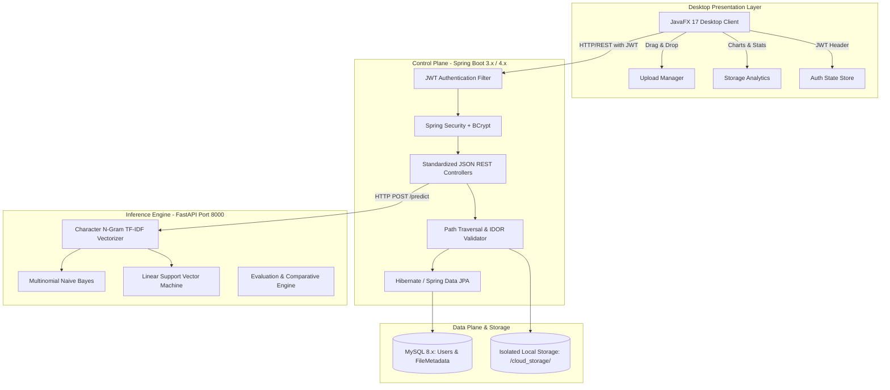

# 📋 Project Transformation & Implementation Plan

> **Project Title:** Intelligent Cloud Drive: AI-Powered File Management System with Secure Distributed Architecture  
> **Course / Academic Track:** 3rd Semester IDP (Inter-Disciplinary Project / Individual Development Project)  
> **Repository:** [`4all3n/mini_Drive`](https://github.com/4all3n/mini_Drive)  
> **Target Branch:** `feature/intelligent-cloud-drive` (or `idp-upgrade`)

---

## 📑 Table of Contents

1. [Executive Summary & Context](#-executive-summary--context)
2. [Document Structure](#-document-structure)
3. [Core Scope at a Glance](#-core-scope-at-a-glance)
4. [Key Architectural Pillars](#-key-architectural-pillars)
5. [The "Why": Addressing Research & Prototype Gaps](#-the-why-addressing-research--prototype-gaps)
6. [Strategic Decision & Alternative Matrix](#-strategic-decision--alternative-matrix)

---

## 🎯 Executive Summary & Context

The `IDP` directory contains the evaluation materials, academic reviews, and architectural proposals for the 3rd-semester project. A thorough audit of the existing codebase (`mini_Drive`) and the documents in `IDP/` reveals the project trajectory:

* **Current Baseline (`main` branch):** A working, multi-component prototype consisting of a JavaFX desktop client, a Spring Boot REST server (with legacy Jakarta servlets for admin functions), a local disk storage directory, a basic MySQL database (`cloud_db`), and a preliminary FastAPI microservice with an in-memory Naive Bayes model.
* **The Problem:** The current baseline has critical vulnerabilities (plain-text passwords, no token authentication, IDOR vulnerabilities, path traversal risks, and brittle delimiter-based API responses), lacks an empirical machine learning study, and requires manual multi-step setup.
* **The Plan:** In a new dedicated branch, we will transform `mini_Drive` into **Intelligent Cloud Drive: AI-Powered File Management System with Secure Distributed Architecture**. This will implement production-grade security (JWT + BCrypt + IDOR/Path Traversal prevention), a comparative ML study (Multinomial Naive Bayes vs. Linear SVM with character n-gram TF-IDF), clean JSON REST APIs, JavaFX desktop UI enhancements, and full containerization via Docker Compose.

---

## 📚 Document Structure

This plan is organized into comprehensive, modular documents located in this directory:

| Document | Purpose & Description |
| :--- | :--- |
| **[`01_project_overview_and_rationale.md`](./01_project_overview_and_rationale.md)** | **What We Are Doing & Why:** Problem statement, research gaps, project objectives, and alignment with academic guidelines. |
| **[`02_architectural_design_and_components.md`](./02_architectural_design_and_components.md)** | **System Architecture & Specifications:** In-depth blueprint of the JavaFX client, Spring Boot backend, FastAPI microservice, MySQL database, and Docker Compose orchestration. |
| **[`03_comparative_analysis_and_alternatives.md`](./03_comparative_analysis_and_alternatives.md)** | **Trade-off Analysis & Alternatives:** Detailed comparisons covering ML models (NB vs. SVM vs. Deep Learning), Auth (JWT vs. Sessions), Hashing (BCrypt vs. Argon2), Client (JavaFX vs. Web), and why alternatives were rejected. |
| **[`04_implementation_roadmap_and_milestones.md`](./04_implementation_roadmap_and_milestones.md)** | **Execution Phases & Verification:** Phased breakdown for Review 3, Draft Review, and Final Viva, including test plans and dataset preparation. |

---

## 🔍 Core Scope at a Glance

---

## 🛡️ Key Architectural Pillars

1. **Zero-Trust Privacy & On-Premise ML:** No user files or metadata leave the local host. All NLP inference runs locally on the FastAPI microservice.
2. **Empirical Comparative Research:** Rigorous side-by-side benchmark of Multinomial Naive Bayes vs. Linear SVM specifically on ultra-short text (5–30 character filenames).
3. **Enterprise-Grade Security:**
   - One-way salted password hashing via BCrypt (cost factor 10+).
   - Stateless authentication via HMAC-SHA256 signed JSON Web Tokens (JWT).
   - Input sanitization and path normalization to eliminate path traversal (`../`).
   - Ownership verification on every file access to prevent IDOR attacks.
4. **Decoupled Control & Data Planes:** Emulates the Google File System (GFS) architectural principle: metadata is managed by Spring Boot in MySQL (control plane), while file bytes reside on the filesystem (data plane).
5. **One-Command Reproducibility:** Multi-container deployment managed through Docker Compose (`docker-compose.yml`).
